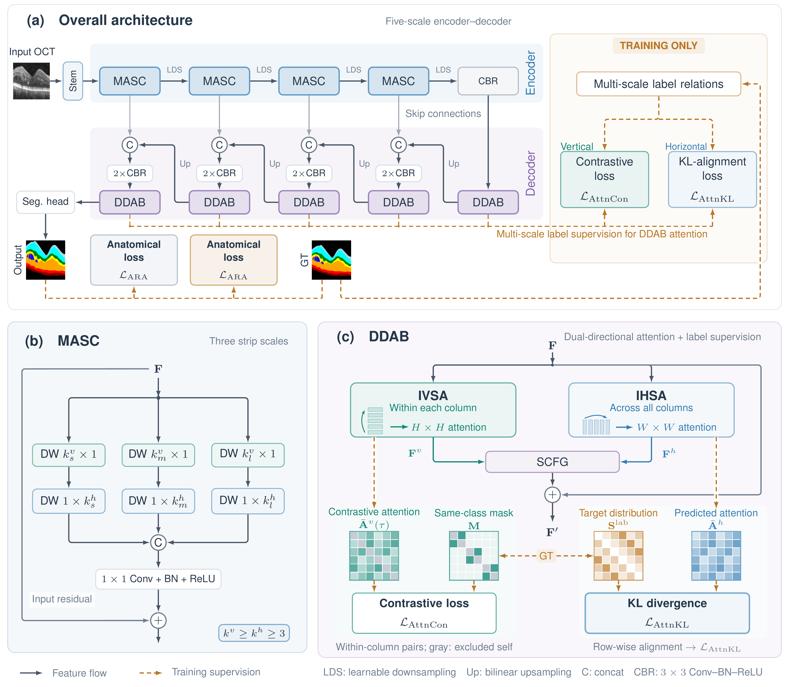

# ADRE-Net

**Anatomy-guided Directional Relation Encoding Network for joint segmentation of retinal layers and pathological fluids in OCT.**

PyTorch implementation of the ADRE-Net method.

Accurate joint segmentation of retinal layers and fluids in optical coherence tomography (OCT) is hard because pathology deforms the retina and obscures tissue boundaries. ADRE-Net exploits the **directional organization of retinal anatomy** — the lateral continuity of layers (horizontal) and their axial ordering (vertical) — and *supervises* the directional feature interactions with label-derived anatomical relationships, instead of leaving them purely data-driven.

<p align="center"></p>

## Demo

A live interactive demo is hosted on GitHub Pages:

**[🌐 https://nuistai.github.io/ADRE-Net/](https://nuistai.github.io/ADRE-Net/)**

It visualizes the dual-directional attention (**IVSA** / **IHSA**) on the three public OCT datasets (Duke DME, AROI, HCMS) and includes a qualitative segmentation comparison against 12 baseline methods (CNN / Transformer / Mamba / OCT-specific).

## Highlights

- **MASC encoder** (Multi-Scale Asymmetric Strip Convolution): direction-aware features via parallel depth-wise strip convolutions (`k×1` + `1×k`) with learnable down-sampling (LDS).
- **DDAB decoder** (Dual-Directional Attention Block): models both directions jointly.
  - **IVSA** — Intra-column Vertical Self-Attention (A-scan / depth direction).
  - **IHSA** — Inter-column Horizontal Self-Attention (B-scan / lateral direction).
  - **SCFG** — Spatial-Channel Fusion Gate that adaptively fuses the two directional features.
- **Label-derived relational supervision** at both the feature level and the output level:
  - `L_AttnCon` — IVSA label-guided contrastive loss (intra-class compactness / inter-class separation within each A-scan).
  - `L_AttnKL` — IHSA column-macro-IoU KL alignment.
  - `L_ARA` — anatomical relationship-aware weighted BCE (containment + layer-order).
- **Anatomy-consistency metrics** beyond Dice: MAD (µm), layer-fragmentation incidence/severity (LFI/LFS), layer-order violation incidence/severity (LOVI/LOVS), and fluid recall/precision.

## Method summary

The network is a U-Net-style encoder–decoder: a five-stage **MASC** encoder
(asymmetric strip convolutions with learnable down-sampling) and a bilinear
decoder with a **DDAB** (IVSA + IHSA fused by SCFG) at the bottleneck and after
each skip-connection fusion.

The total loss follows the paper:

```
L = L_seg + 0.1·L_ARA + 0.5·L_AttnCon + 0.5·L_AttnKL,
    L_seg = L_CE + L_Dice.
```

| Paper term | Code |
|---|---|
| ADRE-Net / MASC / LDS | `adre_net/adre_net.py` |
| DDAB / SCFG | `adre_net/ddab.py` |
| IVSA | `adre_net/ivsa.py` |
| IHSA | `adre_net/ihsa.py` |
| `L_AttnCon` / `L_AttnKL` / `L_ARA` | `losses/` |

## Datasets

Experiments in the paper use three public OCT datasets: **Duke DME**, **AROI**, and **HCMS**. This repository ships the corresponding data loaders (`dataset/`) plus empty split-file templates (see [Data preparation](#data-preparation)).

Each dataset's class definitions (class names, layer/fluid ids, anatomical edges) and image/label folder paths are configured in `configs/{duke,aroi,hcms}_config.py`.

## Repository structure

```
ADRE-Net/
├── adre_net/            # the model
│   ├── adre_net.py      #   ADRE_Net + MASC encoder + learnable decoder
│   ├── ddab.py          #   DDAB + SCFG
│   ├── ivsa.py          #   IVSA (intra-column vertical self-attention)
│   └── ihsa.py          #   IHSA (inter-column horizontal self-attention)
├── losses/              # CE, Dice, L_AttnCon, L_AttnKL, L_ARA + criterion
├── dataset/             # Duke DME / AROI / HCMS data loaders (+ shared transforms)
├── configs/             # argparse configuration (aroi / duke / hcms)
├── main.py              # train + evaluate entry point
├── trainer.py           # training / validation loop
├── evaluate.py          # test-time evaluation + anatomy metrics
├── metrics.py           # Dice
├── anatomy_metrics.py   # MAD / fragmentation / layer-order / fluid metrics
├── visualize.py         # segmentation visualization
├── utils/               # QK attention heatmap helper
├── inputs/              # train / val / test split lists (duke/, aroi/, hcms/)
└── assets/              # architecture figure (overview.png)
```

## Installation

```bash
git clone https://github.com/NuistAI/ADRE-Net.git
cd ADRE-Net
pip install -r requirements.txt
```

Tested with Python 3.8+ and a CUDA-enabled PyTorch.

## Data preparation

1. Download the dataset and set `--img_dir` / `--lab_dir` (and `--layer_lab_dir` for Duke) to the absolute paths of the image and label folders:

   | dataset | `--img_dir` | `--lab_dir` | `--layer_lab_dir` |
   |---|---|---|---|
   | Duke DME | `image/` | `label_full/` | `label_Layers/` |
   | AROI | `image/` | `label/` | — |
   | HCMS | `image/` | `label/` | — |

2. Fill in the split files under `inputs/duke/`, `inputs/aroi/`, or `inputs/hcms/` (they are shipped empty):

   - `train_images.txt`
   - `val_images.txt`
   - `test_images.txt`

   Each file lists image filenames, **one per line, no header**. For example:

   ```
   patient1_raw0035.png
   patient1_raw0037.png
   patient2_raw0001.png
   ```

   The filename must exist in both the image and label folders. Use a subject-level split (keep all B-scans of a patient in the same split) to avoid data leakage.

3. Run training with `--dataset duke` / `--dataset aroi` / `--dataset hcms` and `--outputs_dir` for results (the image/label paths use the config defaults above unless overridden).

## Training

```bash
python main.py \
    --dataset aroi \
    --img_dir /path/to/AROI/image \
    --lab_dir /path/to/AROI/label \
    --outputs_dir /path/to/outputs \
    --backbone adre_net \
    --loss ce_dice_wbce_asup_bkl
```

Full hyper-parameters (optimizer, scheduler, learning rate, batch size, image size, loss, anatomical prior, etc.) live in `configs/{aroi,duke,hcms}_config.py`.

Loss presets in `losses/default.py`:

| `--loss` | terms |
|---|---|
| `ce_dice` | `L_seg` only |
| `ce_dice_asup_bkl` | `L_seg + 0.5·L_AttnCon + 0.5·L_AttnKL` |
| `ce_dice_wbce` | `L_seg + 0.1·L_ARA` |
| `ce_dice_wbce_asup_bkl` | full paper loss (default) |

## Evaluation

The evaluation script reports per-class **Dice** plus the anatomy-consistency metrics **MAD** (µm, using the dataset's `--pixel_spacing`), **layer-fragmentation incidence/severity (LFI/LFS)**, **layer-order violation incidence/severity (LOVI/LOVS)**, and **fluid recall/precision**.

```bash
python evaluate.py --checkpoint /path/to/outputs/aroi/adre_net/...
```

`main.py` also runs evaluation automatically after training and writes `best_result.csv`.

## Checkpoints

Trained checkpoints are not included in this repository. Train them with the command above and place them under your outputs directory. The model loads state dicts with `torch.load(..., weights_only=True)`.

## Attention visualization

The interactive web demo visualizing the IVSA / IHSA attention maps is hosted on GitHub Pages at [https://nuistai.github.io/ADRE-Net/](https://nuistai.github.io/ADRE-Net/).

## License

This project is released under the [MIT License](LICENSE). The Duke DME / AROI / HCMS datasets are subject to their own licenses.
